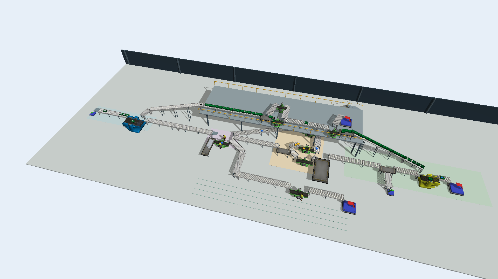

# 循環物流數位分身

用 FlexSim 模擬電商退貨倉庫，比較怎麼減少塞車，以及改善是否划算。商品檢查與循環箱清洗分開進行，最後配箱出庫。

## 實驗告訴我們什麼

- **只加緩衝不夠。** 短波尖峰下，現況拆包阻塞約13.68%；只調整成8公尺緩衝，仍有10.53%。
- **結合調派人員與外包規則，才明顯改善。** 聯合改善方案（P4）搭配12公尺緩衝，阻塞降到約0.35%，檢查前平均等待由16.88分鐘降至5.05分鐘。
- **服務改善不代表投資能回本。** 這個配置需投資12萬元，直接費用估計每年反而增加約1.78萬元；是否採用，還要衡量服務價值。

以上為短波尖峰情境（S1）各配置30次模擬的平均，尚非實倉預測。關鍵比較與限制見[研究報告](重點檔案/研究報告.md)。

## 從這裡開始

| 想做什麼 | 閱讀入口 |
|---|---|
| 第一次接觸專案 | [專案導覽](guide.md)／[五分鐘重點](guide_key.md) |
| 看結果與是否值得投資 | [研究報告](重點檔案/研究報告.md)／[環境與投資評估](重點檔案/環境與投資評估.md) |
| 開啟模型或上台展示 | [模型操作](模型/README.md)／[成果簡報](重點檔案/成果簡報.pptx)／[展示指南](重點檔案/展示指南.md) |

### 附註：需要查證時再看

[全部配置比較](重點檔案/完整方案比較.md) · [完整CSV數據](重點檔案/數據/README.md) · [信效度檢查](重點檔案/信效度報告.md) · [建模說明](重點檔案/建模說明.md) · [名詞對照](名詞與代碼對照.md) · [答辯參考](重點檔案/答辯參考.md)

使用合法授權的 FlexSim 2027 開啟模型。專案採 [MIT授權](LICENSE)，第三方素材見[說明](THIRD_PARTY_NOTICES.md)。

改善前後的模型可從[模型操作頁](模型/README.md)下載，兩者使用相同短波尖峰情境，方便比較。
