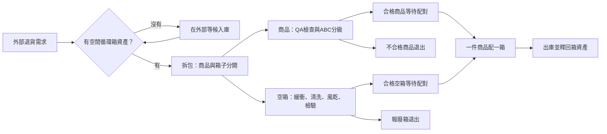

# 專案導讀：先看懂問題，再看模型與數據

這份導讀寫給第一次接觸本專案的組員。你不需要先會寫程式，也不需要先會操作 FlexSim。先讀完前五節，就能說明我們在解決什麼問題、做了什麼，以及結果有什麼限制。

目前版本是 **V8 最終交付**。模型建置、原生實驗、驗證判讀、影片與簡報都已完成；「工作完成」不代表每個商業目標都達標。原始 30 次精度不足、65% 包材節約未達、直接投資回收為負，都有保留在報告中。

## 1. 這個專案在做什麼？

想像你經營一家電商，每天都有商品被退回。退貨進倉後要拆包、檢查、分級、整理，合格商品才能再次出售。裝商品的循環箱也要清洗、風乾、檢查，才能重新使用。

這兩條流程會互相影響：即使商品整理好了，沒有乾淨箱子也不能出貨；如果空箱回堵到拆包區，商品也會被擋在入口。

我們用 FlexSim 建一座可以在電腦裡運作的倉庫，先觀察尖峰時哪裡塞車，再比較不同改善方案。這是一個**以課程設定為基礎的模擬研究**；沒有拿到真實倉庫的訂單或現場量測，所以不能直接保證真實倉庫會改善相同幅度。

## 2. 先認識商品與箱子的兩條路

- **商品分級**：A 級做較簡單整理；B 級需要整新；C 級不能重新出售。模型的隨機分級比例是 60%／30%／10%。
- **循環箱**：池中有 500 個資產名額；每個最多使用 150 次，每次清洗後有 2% 報廢機率。外部退貨請求還沒入庫時，不能假裝它已占用一個實體箱。
- **五位多能工**：不是無限人力。QA 忙不過來時，支援員要真的走到 QA，抵達後才讓檢驗變快。
- **清洗設備**：會故障、會維修；不能假設整天都以理論最大速度運轉。

這裡的「資產池」是模擬中的有限資源管理；不是聲稱追蹤了現實世界每個箱子的實際回收紀錄。

## 3. 我們想回答哪幾個問題？

1. 尖峰時，到底是清洗機太少、QA 太慢，還是缺乏緩衝空間？
2. 增加清洗機、加長緩衝、外包或調派人員，哪一種比較有效？
3. 改善服務品質時，真的有減碳、節省包材成本，而且值得投資嗎？
4. 模型有沒有偷生商品、憑空消失箱子，或讓人員瞬間移動？

先記住一句話：**動畫用來看流程，統計數據用來做結論，驗證用來檢查結論是否站得住腳。**

## 4. 實際做了哪些實驗？

實驗把「輸入條件」與「改善方案」分開。S 代表需求情境，P 代表處方，也就是改善方案。

| 標記 | 新手可以怎麼理解 |
|---|---|
| S0 | 基準需求，平均 60 件／小時。 |
| S1 | 尖峰需求；波外 80 件／小時，三段尖峰各 20 分鐘，尖峰率 210 件／小時。 |
| S1_4.5：高尖峰敏感度 | 把尖峰率提高到 270 件／小時；用來看方案對更高尖峰是否敏感。實際情境代號以 DOE 矩陣為準。 |
| P0 | 不改善，作為 Before。 |
| P1 | 增加第二台清洗機。 |
| P2 | 增加緩衝。 |
| P3 | 外包清洗。 |
| P4 | 緩衝加上人員支援控制。 |

主實驗共 **3 情境 × 15 配置 × 30 次重複 = 1,350 次**。15 配置包含不同處方與緩衝長度，**不是每個處方都任意交叉每個長度**；精確設定請看 `DOE矩陣.csv`。

每次跑 7 個模擬日。前 24 小時是「暖機」：讓一開始空倉的特殊狀態先過去，再統計後面 6 天。隨機種子決定一串可重現的隨機事件；比較方案時使用共同種子，讓比較更公平。

另外做了基準精度補充：600 個基準樣本包含主實驗已有的 30 個，再新增 570 個。因此不重複原生運行是 **1,350＋570＝1,920 次**，不是 1,950 次。

## 5. 組員一定要知道的結果

下表是 S1、每組 30 次的平均值；完整 95% 信賴區間見最終報告與比較 CSV。

| 指標 | Before：P0 | P4 8m | P4 12m |
|---|---:|---:|---:|
| 拆包阻塞時間比例 | 12.221% | 0.951% | 0.711% |
| 平均 Q-Time | 19.714 分鐘 | 5.516 分鐘 | 5.014 分鐘 |
| 結案率保守下界 | 99.824% | 99.942% | 99.944% |
| 課程口徑完整淨減碳率 | 73.853% | 74.146% | 73.995% |
| 包材成本節約率 | 39.553% | 39.073% | 39.173% |
| 額外投資 | 0 元 | 80,000 元 | 120,000 元 |
| 相較 P0 的年淨效益估計 | 比較基準 | −64,374 元 | −50,937 元 |

**為什麼不是直接買第二台清洗機？** QA 一人每件 40 秒，名目能力只有 90 件／小時；清洗考慮故障後的期望能力約 115.2 箱／小時。QA 本身也會塞車，所以 P1 仍有約 3.944% 拆包阻塞。

**8m 還是 12m？** 原訂規則只要求平均阻塞低於 1%，最低投資候選是 8m；如果再要求阻塞率 95% 信賴區間的上界也低於 1%，才選 12m。8m 的區間約 [0.783%, 1.118%]，12m 約 [0.565%, 0.856%]。這是兩種風險要求，不能混著說。

**有賺錢嗎？** 兩個方案相較 P0 的直接年淨效益都為負，沒有正向回收期。相較買第二台洗機，8m／12m 少投資 142 萬／138 萬元，是「避免支出」，不是新增利潤。年化金額由六日模擬推估，不是真實年度帳務。

**65% 包材節約呢？** 沒有達成。箱子每次有 2% 報廢，會拉低實際壽命；完整算入剩餘價值沖銷後，在理想條件下的穩態節約上限也只有約 47.89%。不能把課程目標當成已實現成果。

## 6. 不懂統計也能理解的驗證

| 檢查 | 白話意思 | 本案發現 |
|---|---|---|
| 守恆 | 進來多少，應該等於出去、報廢與還在系統裡的總和。 | 主實驗每次 17 項殘差都是 0。 |
| 同種子重現 | 相同設定與隨機事件，應得到相同結果。 | 三配置各跑兩次，完整原生讀值一致。 |
| 物理產能 | 30 秒洗一箱，不能在沒有理由下洗得比設備上限還快。 | 產能對標有通過，故障與可用時間分開核對。 |
| 導航與調派 | 人要走得到，且到站前不能先算加速。 | 200 段抵達、活動路格占用與指定路段單行檢查均有證據。 |
| 估計精度 | 平均值的不確定性有多大？ | 原始 30 次最差相對 CI 半寬 18.07%，未達 5%；600 基準補充降至 3.47%。 |
| 壓力測試 | 把需求拉到超負荷，是否看得到合理的排隊？ | 300 件／小時跑 7 日，外部積壓 34,185 件、超 24h 11,925 件，服務門檻失敗。 |

95% 信賴區間表達的是用這套抽樣方法估計平均值的不確定性，**不是保證單次運行有 95% 會落在這個區間**。平均值較好，也不等於每次都比較好。

原始 30 次精度未過的紀錄仍保留。600 次只補基準情境，不能說所有 45 配置都已達相同精度。導航測試也是有限測試，不能說已用數學證明任何情況都不死鎖。

## 7. 檔案怎麼看？

### 只剩 10 分鐘

先看 [精華導覽](重點檔案/guide_key.md)，再看精華資料夾中的成果簡報與 `BeforeAfter_v8.csv`，記住「瓶頸、8m/12m、負 ROI、精度補充」四件事。

### 有 40 分鐘，要準備組內討論

依序讀：本導讀 → 最終回報 → 信效度報告 → Demo 腳本 → 答辯 Q&A。看影片時，注意商品與空箱分流、支援員移動，以及畫面上的數字是即時截點還是多次實驗平均。

### 要負責操作或技術答辯

看完整交付中的 `可重現步驟_v8.md`，再開 `Experimenter結果.csv`、`基準精度600次_v8.csv` 與 `DOE矩陣.csv`。需要鑽研原始讀值時，才往原生 Experimenter 正式資料與建模程式追。

| 資料夾／檔案 | 用途 |
|---|---|
| `重點檔案/` | 組員的第一站：導覽、簡報、主要報告、比較數據、圖片與影片。 |
| `專案二_交付/01_SA/` | 系統設計、資料流、假設與 KPI 定義。 |
| `專案二_交付/02_模型/` | 原生模型、Before/After、Experimenter 模型與資料庫。 |
| `專案二_交付/03_驗證/` | V1–V11、守恆、導航、Console 與驗收證據。 |
| `專案二_交付/04_實驗/` | DOE、逐次數據、精度補充與財務分析。 |
| `專案二_交付/05_發表/` | PPT、圖片、影片、Demo 與答辯資料。 |
| `專案二_交付/06_PM/` | 工作狀態與風險；可看到「已完成工作」和「未達目標」的差別。 |
| `mcp_flexsim/` | MCP/SDK 與建模開發歷程，包含暫存和歷史試驗；不是新手起點。 |

完整工作目錄中有 v3、v7 和早期 v8。這些是歷史紀錄，不能混入 V8 正式分析。以 `專案二_交付/README.md` 指向的最終檔案為準。

## 8. 要實際開模型時

這一節適用於**組內完整交付**；GitHub 公開版不含未完成可公開性審核的原生模型與資料庫。

1. 電腦需要可用的 FlexSim 2027 與相應授權；本專案不包含 FlexSim 安裝程式或授權。
2. 在完整交付的 `02_模型/` 開 `V8_GUI_循環物流_最終完成版_20261029.fsm`。
3. 既有快照在 116100 秒，按 Run 可以接著跑；需要從頭驗證時按 Reset 再 Run。模型內的 Dashboard 更新邏輯會在 Reset 後啟用。
4. `開啟V8即時展示.cmd` 是原建置電腦的便利入口；其他電腦若安裝位置不同，直接用 FlexSim 開 FSM。
5. 看既有 Experimenter 結果時，`V8_原生Experimenter_完整結果可開啟.fsm` 與**同名 `.sqlite`** 必須一起放。先查看已有結果，不要不小心重跑 1920 次。

即時 Dashboard 的單一截點不等於六日觀察期平均。圖表可以用來解釋過程，簡報結論仍應使用正式統計資料。

## 9. 小字典與分工建議

| 詞彙 | 白話解釋 |
|---|---|
| 數位分身 | 用數位模型呈現系統。本案尚缺現地資料校準，應稱課程假設下的原生模擬。 |
| QA | 品質檢查站；別和答辯 Q&A 混淆。 |
| WIP | 還在系統內、尚未完成的在製品或工作量。定義要看是商品、箱或外部請求。 |
| Q-Time | 本案從外部到達到開始 QA 的時間，包含入庫節流等待。 |
| Blocked | 下游接不走，導致上游被擋住。 |
| Process Flow | 用事件與流程節點控制邏輯；與 3D 物料移動相互配合。 |
| A* | 找路的方法。找得到短路還不夠，也要顧及通行方向與活動路格分配。 |
| Experimenter／DOE | 批次比較不同設定的工具／實驗設計。 |
| Replication／Seed | 一次重複實驗／控制隨機事件序列的種子。 |
| ESG | 本案主要研究環境面指標；不是已完成企業全部 ESG 評鑑。 |
| ROI | 投資報酬率。本案 8m 與 12m 相較 P0 的直接財務 ROI 都為負。 |

建議按實際人數分工：一人說商業問題與假設，一人說模型與調派，一人說驗證與統計，一人說財務與展示。每個人都要能回答：「為什麼 8m 和 12m 都會出現在結論？為什麼服務變好卻沒有回本？」

## 10. GitHub 公開版與組內原件

`GitHub_公開版/` 是獨立的發布資料夾，採明確清單收錄。原工作目錄仍保留本機路徑、開發設定、歷史紀錄與原生二進位檔，**不要在原工作目錄直接執行 `git add .`**。

公開版提供教學導讀、去識別報告、模擬結果 CSV、精華圖片／影片及移除文件中繼資料的簡報。原始課程教材、參考模板、SDK、虛擬環境、帳號設定、原始日誌與未完成深度檢查的 FSM／SQLite 不收錄。公開版是可查閱成果與數據的發布包，不是完整原生運行環境。

本專案使用模擬需求，沒有真實客戶訂單。公開檢查的規則、範圍與限制，請看公開版的 `SECURITY_REVIEW.md`，不要把「自動掃描未發現」說成對任何形式資訊洩漏的絕對保證。
