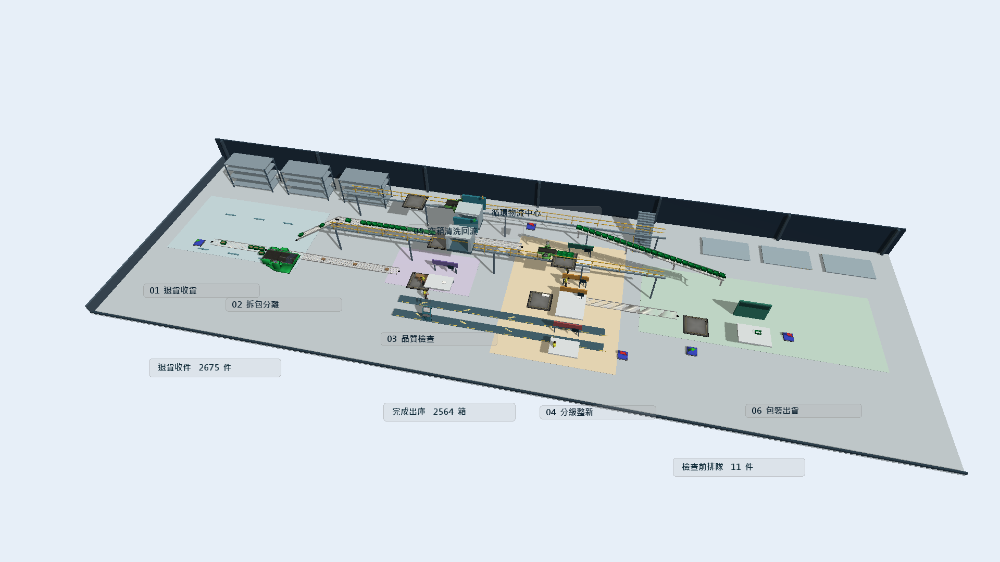
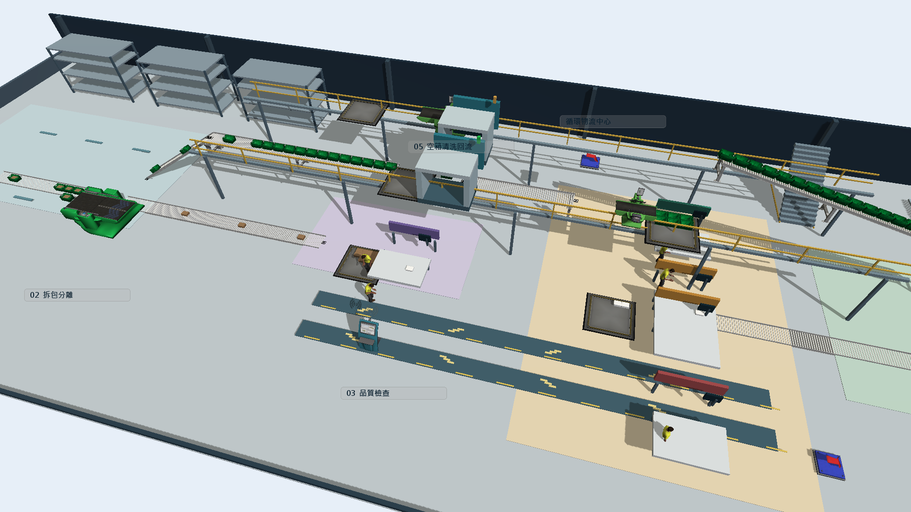

# 用 FlexSim 開啟原生模型

這裡提供可實際操作的模型，不是影片。需要自行安裝並合法授權 **FlexSim 2027**；本儲存庫不附軟體、授權或本機開發環境。其他版本的相容性未驗收。

## 先選檔案

| 檔案 | 用途 |
|---|---|
| [循環物流_3D展示.fsm](循環物流_3D展示.fsm) | 第一次操作先開這個。主推聯合改善：12公尺緩衝＋人員支援＋觸發式外包。 |
| [改善前_現況.fsm](改善前_現況.fsm) | 改善前對照，維持現況。 |
| [改善後_聯合改善12公尺.fsm](改善後_聯合改善12公尺.fsm) | 改善後對照，與3D展示相同方案。 |
| [循環物流_實驗完整結果.fsm](循環物流_實驗完整結果.fsm) | 開啟批次實驗工具（Experimenter），查看既有實驗配置與績效結果。 |
| [循環物流_實驗完整結果.sqlite](循環物流_實驗完整結果.sqlite) | 上一個模型的配套結果資料庫，兩個檔案必須保持同名、放在同一資料夾。 |

`.fsm` 是 FlexSim 原生模型；`.sqlite` 是儲存結果的資料庫。物流計算版本仍是 V8；畫面更新為 V9 中文場景。兩段實驗輸出維持相對位置。新場景只有分區、設備外觀、支架、備品架及中文即時標示，沒有修改產能、人員數、尋路規則或成本公式。

## 第一次運行

1. 建議下載整個儲存庫並解壓，先保留備份，於可寫入的資料夾操作；不要只下載網頁上的檔案預覽。
2. 在 FlexSim 開啟 `循環物流_3D展示.fsm`。已存快照約在模擬第116100秒，可以先看設備和人員佈局。
3. 若沒有3D畫面，先新增3D視窗（Perspective View）；若中文呈方框，請依下方「中文字型」設定並重新啟動 FlexSim。按「重設／Reset」回到起點，再按「運行／Run」。重設會啟用每秒更新兩次的儀表板。播放速度可以自行降低，方便觀察人員走動。
4. 找到即時儀表板（Dashboard）分頁，觀察在製量與清洗機狀態；單一時間點的數字不等於報告的六日觀察期平均。
5. 用改善前、改善後兩個模型做對照。這裡的 **短波尖峰情境（S1）** 指每天三波、每波20分鐘的短波尖峰；**維持現況方案（P0）** 指現況，**聯合改善方案（P4）** 指三項聯合改善。8／12公尺是緩衝長度，不能與等待分鐘混淆。其他代碼見[名詞對照](../名詞與代碼對照.md)。

## 查看批次結果或重新實驗

開啟 `循環物流_實驗完整結果.fsm`，再開批次實驗工具（Experimenter）。既有主實驗為45種配置各30次，共1350次；精度補充新增570次，總共1920次不重複運行。600個基準樣本包含主實驗重用的30個，不可把1350＋600當成不重複次數。

先查看已有結果。若要重跑，請先把模型、同名資料庫及 `experiment_exports` 資料夾複製到另一個可寫入的資料夾；重跑會更新結果資料庫，並把每次暖機／結束的JSON紀錄寫入旁邊的 `experiment_exports`。不要同時在兩個程式視窗修改同一資料庫。部分軟體版本或授權可能限制批次實驗／平行實驗功能。

本次公開版以相同隨機種子，對短波尖峰下的現況與聯合改善12公尺各跑完整七天，暖機24小時及七天結束的量測、驗證、資產池資料與原模型完全一致。這是公開處理的回歸檢查，沒有新增或改寫正式1920次實驗的統計結果。

## 安全範圍

四個模型已檢查完整解壓內容的文字模式；資料庫已清理未使用頁面、逐表核對數值，並檢查結構、文字欄位與二進位內容。未附登入資訊、本機設定、原始日誌、實倉訂單或個人客戶資料。詳見[發布檢查](../SECURITY_REVIEW.md)及[公開模型驗收](../重點檔案/驗證摘要/公開模型驗收.json)。這些檢查不是對未知格式或所有秘密的絕對保證。

教學假設尚未經實倉校準；直接投資報酬率為負、包材節約65%未達標等限制照原報告保留。

## 中文字型與新版場景

畫面上的方框來自原3D字型缺少中文字形。這次已在實際展示電腦改用微軟正黑體粗體，關閉後重新開啟驗證；不能只改字型名稱後沿用舊視窗。

其他組員若仍見方框，請先確認 Windows 已有微軟正黑體，開啟 FlexSim 的樹狀檢視（Tree View），在 **VIEW → environment → fonts → threedviews → name** 將 `arialbd.ttf` 改成 `msjhbd.ttc`，儲存環境偏好設定，再完整關閉並重新開啟 FlexSim。這是整個軟體的3D字型設定，需要在各展示電腦各做一次；不需要把模型文字轉成另一種編碼，也不要把中文物件重新命名。

若使用 FlexScript 主控台，以下三行會設定同一項偏好並存入軟體的使用者設定位置。先關閉其他 FlexSim 視窗，執行後完整重開程式：

```cpp
node("VIEW:/environment/fonts/threedviews/name").value="msjhbd.ttc";
savebyname(node("VIEW:/environment"),userdatadir()+"prefs.t");
return 1;
```

樹狀檢視中的程式識別名稱維持原樣，避免破壞物流腳本；場景用「品質檢查」「分級整新」等中文顯示名稱協助閱讀。若看不到作業區標示，請在3D視窗開啟「顯示物件名稱／標籤」，新版已逐一隱藏無關的預設名稱。





上圖是重設後實際運行至116100秒的截點。收件、出庫與排隊標示直接讀取模型；不能把單一截點當作六日觀察期平均，也不能把設備顏色稱為熱力圖。重新開啟的原生視窗主控台沒有錯誤訊息。

改版前後用相同種子，對維持現況方案（P0）與聯合改善方案（P4）各重跑七天，於24小時與七天末逐項核對，數值完全相同。詳見[中文場景更新驗收](../重點檔案/驗證摘要/中文場景更新驗收.json)。護欄、樓梯、貨架與設備外殼是展示場景；原有直接連接埠轉移的搬運時間假設仍保留，不能解讀成已建模所有商品搬運。
