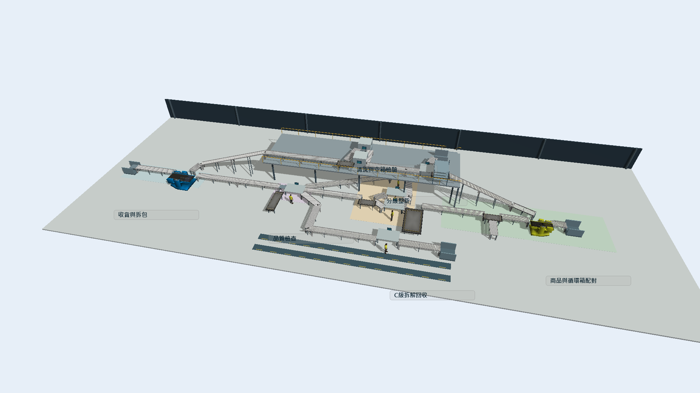
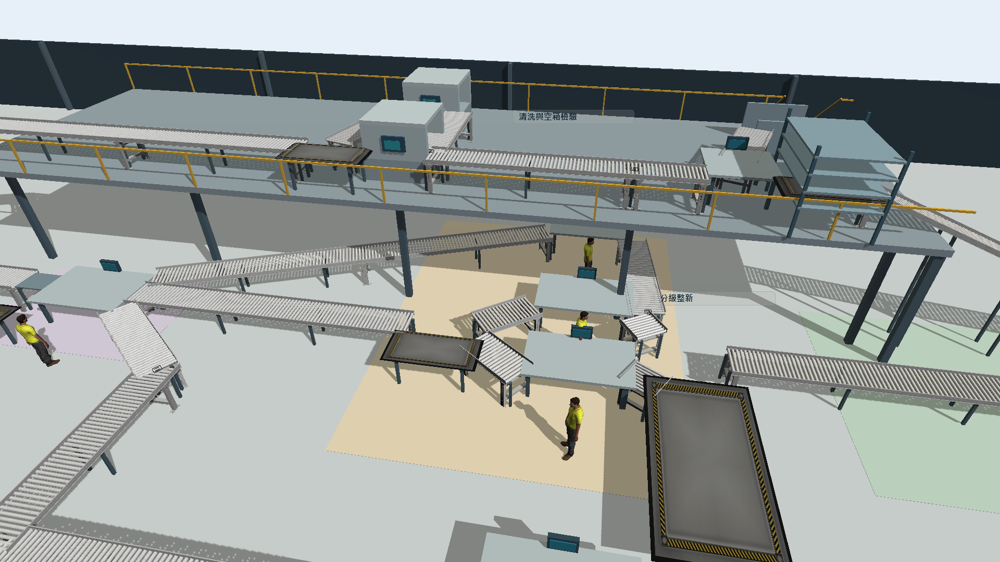

# 原生模型怎麼開｜實體連線修正版（V10）

**先開 `循環物流_3D展示.fsm`。本次修正浮空、輸送帶交接與設備支撐；所有新版檔案都停在模擬時間 0，沒有再啟動運行或實驗。**

## 檔案選擇

| 想做什麼 | 開啟檔案 | 要知道的事 |
|---|---|---|
| 看這次修好的場景 | [循環物流_3D展示.fsm](循環物流_3D展示.fsm) | 短波尖峰情境（S1）、聯合改善方案（P4）、12公尺緩衝；這是配置示範，尚無新版正式統計結論。 |
| 看現況配置 | [改善前_現況.fsm](改善前_現況.fsm) | 短波尖峰情境（S1）、維持現況方案（P0）、1公尺緩衝。 |
| 看改善配置 | [改善後_聯合改善12公尺.fsm](改善後_聯合改善12公尺.fsm) | 與新版展示相同的配置。 |
| 開啟使用者原先指定的檔名 | [循環物流_實驗完整結果.fsm](循環物流_實驗完整結果.fsm) | 已換成新版實體路徑。檔名為相容保留；其中實驗工作明確標為「尚無正式結果」，不是已完成的新版批次結果。 |
| 查原報告的已完成實驗 | [歷史V8_實驗完整結果.fsm](歷史V8_實驗完整結果.fsm) ＋ [同名資料庫](歷史V8_實驗完整結果.sqlite) | 舊版模型與資料庫完整保留，必須同名、同資料夾；1920次不重複運行屬於歷史計算版本（V8）。 |

原生模型檔（FSM）需要另行安裝合法授權的 FlexSim 2027。結果資料庫（SQLite）只配對歷史版；不要把它改成新版的檔名，也不要把舊結果說成新版的結果。

## 第一次觀看

1. 下載整個儲存庫，在可寫入的資料夾解壓並保留備份，再開啟新版展示。
2. 如果沒有3D視窗，新增透視視窗（Perspective View）。先保持停止狀態；本次交付的檢查圖片均為時間0的靜態畫面。
3. 用視窗的旋轉／環繞功能，依序看正面低視角、左右側、背面及俯視。不同滑鼠設定的操作方式可能不同，可從3D視窗工具列選取對應的視角控制。
4. 先看下降回流帶是否真正從上層接到下層，再看平台下方支柱、輸送帶支腳、工作台腳、樓梯扶手，以及分級後的合流交接。
5. 放大品質檢查、分級合流、清洗入口與包裝入口。不要只憑一張鳥瞰圖判斷是否接合。可對照[十張原生多視角圖片](../重點檔案/模型畫面/V10_多視角檢查/)。

這次沒有啟動動畫、短跑或批次實驗；要檢查的對象是實際模型幾何，不是重新計算研究數據。最終版在負載下的動態行為尚未重新驗證，不能把靜態通過當成永不卡住的保證。

## 本次具體修正

- 新增20段原生輸送帶，合計27段，補上分級、清洗、空箱回流、商品與包裝交接。
- 修正下降輸送帶的高度定義：原生物件的位置高度是外框底部，不能直接當成下降段的起點高度。
- 上層平台面高4公尺，上層輸送面約5公尺，下層輸送面約1公尺；補上平台支柱、輸送帶支腳、護欄、樓梯與空箱架。
- 補上有支腳的工作台、清洗設備外殼，將人員初始位置移到台側，清除舊運行狀態留下的空中箱件。
- 品質檢查待檢容量24件，B級待處理容量8件，分級合流工作單元容量8件。有限容量會影響排隊，這次並非只有換外觀。
- 尋路障礙更新到新增設備與立柱；外包清洗的延遲節點放在廠區外並隱藏示意外形，仍是模型邊界外的簡化流程。

## 中文仍然顯示方框時

先確認電腦已安裝微軟正黑體。在樹狀檢視（Tree View）的 **VIEW → environment → fonts → threedviews → name**，將3D字型設成 `msjhbd.ttc`，儲存環境偏好設定，再完整關閉並重開 FlexSim。字型設定屬於各電腦的軟體環境，不要改掉模型內的中文物件名稱。

## 結果與限制

舊版簡報、影片、1350次主實驗與600個基準樣本仍屬於歷史版本（V8）；600個基準樣本重用主實驗中的30個，所以不重複運行總數為1920。原有12公尺建議、減碳比例與投資報酬率不能直接套用到本次修正模型（V10）。

完整修正及逐視角檢查說明見 [V10修正說明](../重點檔案/08_V10實體修正與多視角檢查.md)，檔案與檢查紀錄見 [公開模型驗收](../重點檔案/驗證摘要/公開模型驗收.json)。尺寸為教學設計，尚未經實倉或供應商圖面校準。

