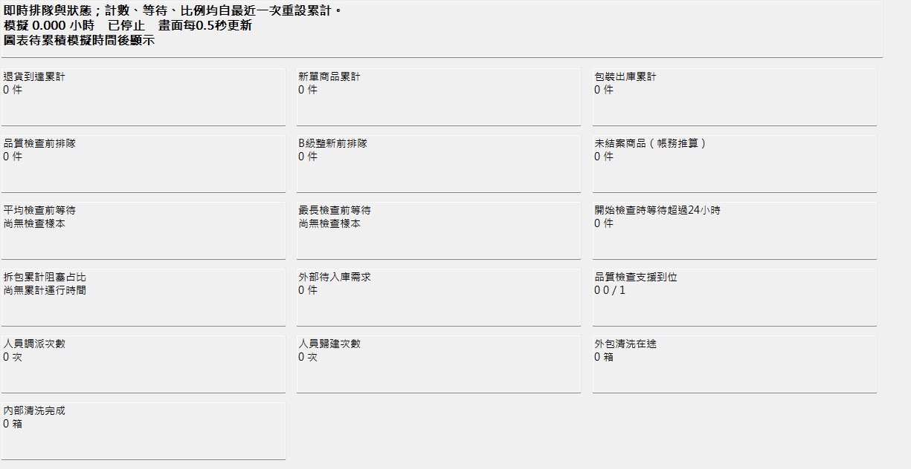
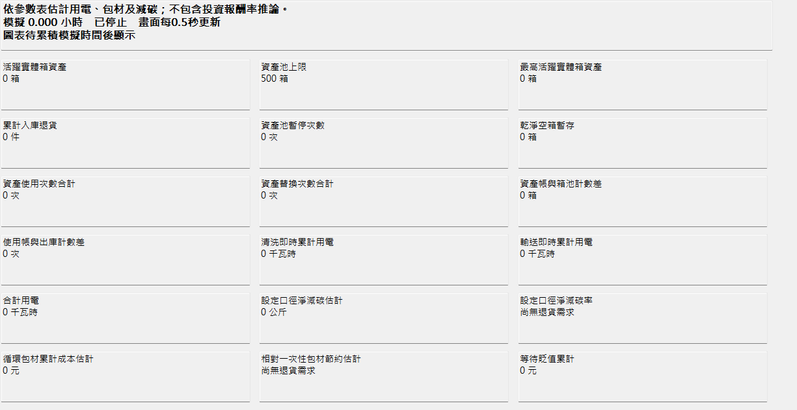

# 模型內儀表板

## 開啟與切換

用 FlexSim 2027 開啟[循環物流.fsm](循環物流.fsm)，「作業總覽」會隨模型開啟。其他分頁位於工具箱（Toolbox）的儀表板（Dashboards）分類，雙擊名稱即可開啟。可將分頁拖到3D視窗旁並排，也可拖出成獨立視窗；放大儀表板可同時看到更多欄位與圖表，較長的分頁可向下捲動。

儀表板與讀值程序都存於模型中，開啟後不需要另外啟動連線服務。模型存於停止狀態、模擬時間為0；儀表板的畫面更新不會讓模擬時間前進。

## 五個分頁

| 分頁 | 內容 | 怎麼看 |
|---|---|---|
| 作業總覽 | 16個欄位；商品排隊趨勢與清洗機狀態圖 | 看退貨、新單、出庫、待檢、等待時間、阻塞與支援情形 |
| 設備與人員 | 10個加工設備、6個暫存或分流單元、27段輸送帶、5名人員；人員狀態圖 | 設備顯示狀態、目前件數與投入／產出；暫存單元另列容量，人員另列位置 |
| 箱資產與能耗 | 18個欄位；用電與箱資產趨勢圖 | 看500箱上限、活躍箱、資產帳差、用電、減碳及成本估計 |
| 指標明細 | 模型量測表的全部45個欄位 | 各欄位附中文名稱與單位，查原始累計量、比例與排程讀值 |
| 參數設定 | 參數表的全部59個欄位 | 唯讀查看需求、工時、功率、費率與策略；情境及方案顯示中文名稱與代碼 |

五個分頁共186張讀值卡，包含重複呈現的重點指標、設備資訊與參數，並非186種獨立績效指標。模擬時間為0時，圖表會等待累積時間後顯示；沒有完成檢查的等待樣本時，平均與最長等待會顯示「尚無檢查樣本」。

## 讀值畫面

以下截取儀表板的讀值區，模擬時間為0；等待樣本尚未產生。

## 更新頻率與數字的範圍

畫面約每0.5秒重讀一次模型，實際速度會受電腦與介面負載影響。設備狀態、件數及人員位置讀取目前值；事件計數在作業發生後變動。「指標明細」中標示「排程讀值」的欄位，仍依原有量測排程更新，預設每600個模擬秒一次；畫面刷新不代表量測排程也每0.5秒執行。

總覽的計數、平均等待及阻塞占比，自最近一次模型重設起累計。設備的運轉、阻塞、停機占比，也使用這段累計模擬時間。人員位置以公尺表示，三個數字依序為水平位置、縱向位置及高度；支援旗標的0表示未到位、1表示已到位。

趨勢線在畫面讀值時取樣，以模擬時間作為橫軸；停止時不重複增加同一時刻的樣本。高速模擬可能跨過中間變化，因此趨勢圖適合現場觀察，不能取代逐次實驗資料或完整事件紀錄。

## 幾個容易誤讀的欄位

- **未結案商品（帳務推算）**＝退貨到達＋新單商品－包裝出庫－商品報廢，是計數帳推算，不是逐件掃描3D世界的物件數。
- **平均檢查前等待**只計算已開始品質檢查的商品；「開始檢查時等待超過24小時」也不包含尚未開始檢查、仍在排隊的商品。
- **外部待入庫需求**尚未取得實體循環箱，與活躍箱資產分開計算。
- **資產帳與箱池計數差**比較資產帳的活躍旗標總數與箱池控制器計數；**使用帳與出庫計數差**比較資產累計使用次數與包裝出庫數。這兩個差值不能單獨替代所有守恆式檢定。
- **用電、減碳及成本**依狀態累計時間、功率、電價與排放係數等教學設定估算，並非電表實測，也不是投資報酬率。減碳率與包材節約率沿用退貨需求基準，不能直接解讀為每一件已出庫商品的效益。
- 「指標明細」的比例欄位保留原值，例如0.74代表74%；總覽及箱資產分頁標示「%」者已換算為百分比。

儀表板顯示目前這一次模型的狀態，不會產生30次重複實驗的平均值或95%信賴區間。研究數據的暖機排除、觀察期間及配置假設，另見[數據說明](../重點檔案/數據/README.md)與[信效度報告](../重點檔案/信效度報告.md)。

## 修改設定

請到全域表格（Global Tables）的參數表（Params）修改，並依[模型操作](README.md)讓初始化程序同步生效。儀表板的參數分頁只供查看。重設模型會清除該次運行的累計統計與趨勢紀錄。
